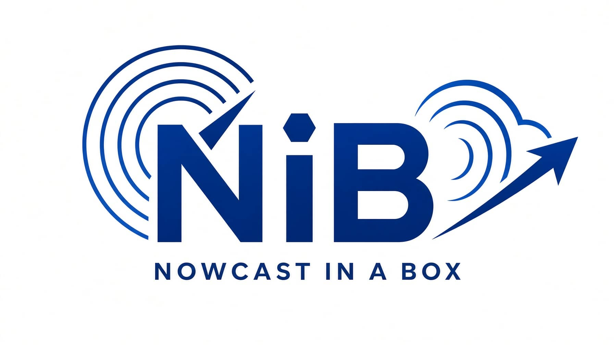

<p align="center">
  
</p>


<h1 align="center">Nowcast-in-a-Box</h1>

<p align="center">
  Run AI precipitation nowcasting models on your computer (or in the cloud).<br>
  Install Docker, start a launcher, and select a model in the browser.
</p>


<p align="center">
  <a href="https://github.com/Nowcast-in-a-Box/Nowcast-in-a-box/releases"></a>
  
  
  
  
  <a href="https://github.com/Nowcast-in-a-Box/Nowcast-in-a-box/stargazers"></a>
  <a href="CONTRIBUTING.md"></a>
</p>
**Nowcast-in-a-Box (NiB)** is a local runtime for AI precipitation nowcasting. It connects your radar or satellite files to models, runs them in Docker, and saves the forecasts. You don't write code, and you don't install Python.

The Hub webpage makes the selection. The Handler, a small local program, does the work.

## What you get

- One local Handler that starts the containers and keeps a record of each run.
- A forecast for each run, saved as files that stay on your disk.
- Comparison images, animations, and optional metrics for each run.
- A failed run that stays on disk with its log, so you can read what went wrong.

## Requirements

- Docker Engine (Docker Desktop on macOS and Windows).
- A release package for your operating system.
- Several GB of free disk space for images, weights, and runs.
- Your observation files, in a format listed under [Supported data](#supported-data).

The first run downloads container images from a registry and weights from Hugging Face. It needs a network connection. Later runs use the local copies.

## Quick start

1. Install Docker. Follow the [Docker Engine instructions](https://docs.docker.com/engine/install/). If Docker already runs on this computer, go to step 2.
2. Download the release package for your system from [Releases](https://github.com/Nowcast-in-a-Box/Nowcast-in-a-box/releases). Use `Nowcast-in-a-Box-<version>-macos.zip`, `-linux.zip`, or `-windows.zip`.
3. Extract the zip to a folder where you keep your work.
4. Start the Handler from that folder. Use the launcher for your system under [Start and Stop](#start-and-stop).
5. Open the Hub and allow the browser to open the local Handler when your system asks. If this is your first run, the launcher registers the `nib://` link for later starts.
6. Choose a data source, then a model, select the sample window, and run the job.

The package holds the launchers for its own system and the amd64 and arm64 Handler binaries. It also holds `config.yaml`, the generated `resources/` tree, and empty `artifacts/` and `runs/` folders. It holds no Go source and no tests.

> If Docker pulls are slow, open the Local page in the Hub and select "China mirror (NJU)". The mirror is optional and read-only.

## Start and stop

Start the Handler with the file for your system.

| System | Start | Command line (for advanced users) |
| --- | --- | --- |
| macOS | Double-click `Start NiB.command` | `bin/macos/start.command start` |
| Linux | Run `Start NiB.sh` | `bin/linux/run.sh` |
| Windows | Double-click `Start NiB.cmd` | `bin/windows/run.ps1` |

The Handler keeps running after you close Terminal or the Hub page. It doesn't start at login and doesn't restart after a crash.

```sh
# e.g. macOS
bin/macos/start.command status
bin/macos/start.command stop
bin/macos/start.command restart
```

The `stop` and `restart` commands refuse while a job is queued, running, or holds the execution resource. Wait for the job to finish first. This release has no force-cancel operation.

## Remove the local Handler

Run the uninstaller to return your system to a fresh state.

- macOS: `Uninstall NiB.command`
- Linux: `Uninstall NiB.sh`
- Windows: `Uninstall NiB.cmd`

The uninstaller stops the Handler and removes the macOS app (if on macOS), the launchd job, the `nib://` registration, the local cache, `nib-settings.json`, and the Handler log. It keeps `runs/`, `artifacts/`, and your data folder.

-  `--dry-run` to list the planned paths.
- `--purge` to also remove generated runs, artifacts, `resources/`, logs, and downloaded binaries.
  - The `--purge` option never removes your data folder.

## Supported data

The Hub lists every data source that the package supports. Each data source ships with a reader, and each model ships as its own container image.

| ID | Data source | Variable | Cadence | File format | Paired models |
| --- | --- | --- | --- | --- | --- |
| `cma_radar` | CMA Radar CREF mosaic | Composite reflectivity, dBZ | 6 min | `.npz`, `.bin` | NowcastNet |
| `sevir` | SEVIR VIL | Vertically integrated liquid | 5 min | `.h5` | NowcastNet, exPreCast, WADEPre |
| `gk2a` | GK2A AMI L1B | All channels | 10 min | AMI L1B | None yet |
| `himawari9` | Himawari-9 AHI HSD | All channels | 10 min | HSD | None yet |
| `fy4b` | FY-4B AGRI L1 | All channels | 15 min | AGRI L1 | None yet |
| `mtg` | MTG FCI L1c | All channels | 10 min | FCI L1c | None yet |


The satellite readers record the region from the file and do not crop it. The CMA radar reader can crop to a box. Every paired model uses the `precip-nowcast.v1` task.


## How it works

```text
NiB Hub (browser)          selects data, model, and sample window
      │
      ▼
Handler (local program)    preflight, container start, run records
      │  Docker Compose
      ├── Data Ingestion       reads files under a read-only mount
      ├── Model Container      one image per algorithm, no network
      └── Diagnostics          comparison images, animation, metrics
      │
      ▼
artifacts/  weights        runs/  one folder per run
```

The Handler listens on the loopback interface only. It starts one container per model and one diagnostics container for the result views. Inference runs with `--network none`, because the weights are already on disk. Each weight file has a pinned Hugging Face revision and a SHA256 checksum; if the checksum doesn't match, it downloads the file again.

Diagnostics run after the models finish. A model can be selected without diagnostics, and the job then ends as `succeeded/finished`. A failed diagnostic leaves the forecast files in place and marks the run `partial`, with the container log next to it.

## Where your files go

| Path | Contents |
| --- | --- |
| `artifacts/` | Weight files and generated Docker files. You can delete this folder because the next run downloads the files again. |
| `runs/` | One folder per run: forecast files, `job.json`, container logs, and diagnostic output. |
| `nib-settings.json` | The data folder that you selected for each data source. Written with mode 0600. |
| `config.yaml` | Host settings for this installation. |

These paths are relative to `config.yaml`. Delete `nib-settings.json` to make the Handler ask for a data folder again.

## Configuration

`config.yaml` holds host settings only. It never selects a dataset, a data file, or a container image. The Hub makes that selection, and the manifests under `resources/` define each container.

| Key | Meaning |
| --- | --- |
| `handler.host`, `handler.port` | API address for the Handler. Default `127.0.0.1:8765`. |
| `review.host`, `review.port` | Address for the saved result pages. Default `127.0.0.1:8766`. |
| `diagnostics.host`, `diagnostics.port` | Loopback address of the diagnostics container. Default `127.0.0.1:8767`. |
| `paths.artifacts` | Weight and Docker file cache. |
| `paths.runs` | Root folder for run output. |
| `paths.resources` | Root that holds the `runtime.yaml` manifests. |
| `runtime.image_registry` | Registry for missing images. Default `ghcr.io/nowcast-in-a-box`. |
| `runtime.image_mirror` | Optional read-only mirror. Default `ghcr.nju.edu.cn/nowcast-in-a-box`. |
| `runtime.image_source` | `auto`, `official`, or `mirror`. |
| `runtime.allowed_origins` | Exact Hub origins that the browser can connect from. Never `*`. |
| `runtime.max_batch_samples` | Largest batch of sample windows in one run. |
| `runtime.atlas_revision` | Atlas revision that the package was built with. |

The Handler binds to loopback addresses only. If you change an address or a port, restart the Handler with the same `config.yaml`. A plain `start` refuses to keep using old execution settings.

See [Handler lifecycle and connection](docs/handler-lifecycle.md) for the compatibility rules, the trusted origins, and the log location.

## Build from source

Contributors need Go 1.22 or later. Users do not build the Handler.

```sh
go build -o "bin/nib-handler$(go env GOEXE)" ./handler/cmd/nib-handler
go test ./...
scripts/cross-build.sh
```

The Handler code is in `handler/`. Data readers and model programs are in `adapters/`, one folder per data source, with each model below its data source. `adapters/catalog.json` is the index that the Hub reads. Container definitions live next to the code that they run, in `runtime.yaml` and `Dockerfile` under each data and model folder. Python formatting uses `scripts/format-python.sh` with `black.toml`.

The release packages are built by the release workflow from a `v*` tag on `main`. The package script is `scripts/package-resources.sh`, and the zip holds user files only.

## Documentation

| Document | Contents |
| --- | --- |
| [docs/cma-demo.md](docs/cma-demo.md) | Reference demo with CMA radar and NowcastNet. |
| [docs/models.md](docs/models.md) | Model list, weights, and checksums. |
| [docs/weights.md](docs/weights.md) | How weights are pinned and checked. |
| [docs/handler-lifecycle.md](docs/handler-lifecycle.md) | Start, stop, ports, and platform limits. |
| [docs/runtime-resources.md](docs/runtime-resources.md) | `runtime.yaml` schema and the resources tree. |
| [docs/local-acceptance-runbook.md](docs/local-acceptance-runbook.md) | Steps for a manual acceptance test. |
| [docs/](docs/) | All architecture notes. |

## Contributing

Read [CONTRIBUTING.md](CONTRIBUTING.md) before you start. Do not start work before an issue is assigned to you. Work IDs are GitHub issue numbers, branches are `feat/short-slug`, and commits are `feat: … (#12)`.

Bugs and feature claims are both useful. Open an issue and describe the run, the operating system, and the message that you saw.

## Credits

We thank the following projects.

- [MLCast](https://mlcast.org/)
- [NCAR-MILES](https://github.com/NCAR/miles-credit/)
- [NVIDIA Earth2Studio](https://nvidia.github.io/earth2studio/main/)
